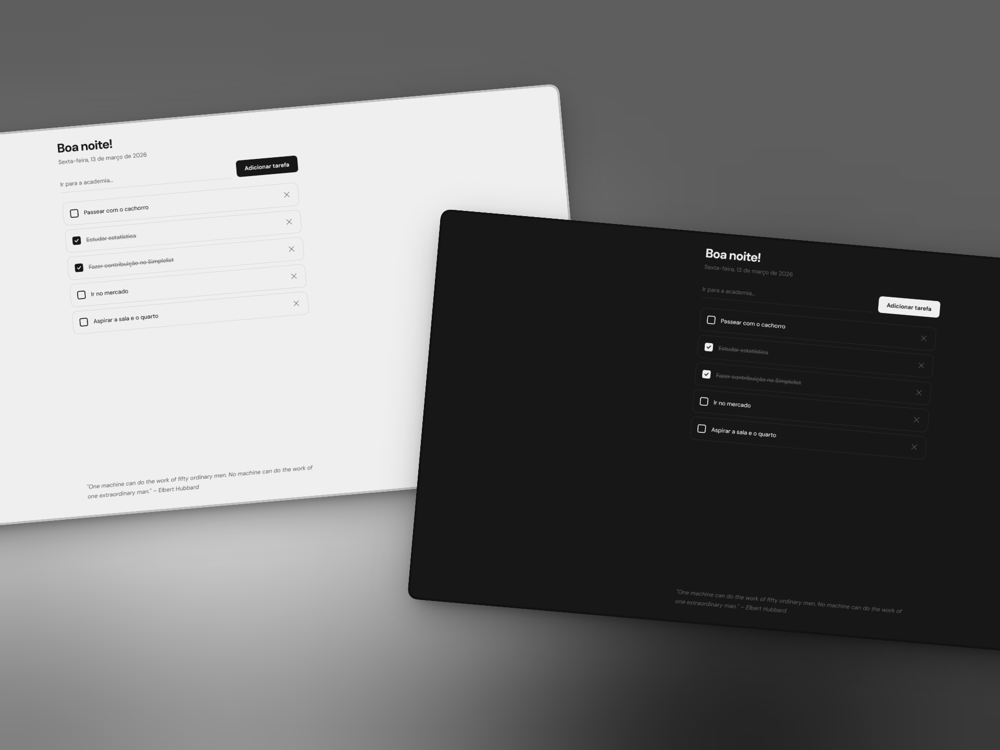

# Simplelist

Simplelist - Keep it simple. Minimalista e focado no essencial.



## Funcionalidades

- **To-do List:** Lista de tarefas com persistência local.

## Tecnologias

- React (com TypeScript)
- Vite
- Tailwind CSS

## Como rodar o projeto

1. **Clone o repositório:**
   ```bash
   git clone https://github.com/KachanChK/Simplelist.git
   ```

2. **Entre na pasta:**
   ```bash
   cd simplelist
   ```

3. **Instale as dependências:**
   ```bash
   npm install
   ```

4. **Rode o projeto localmente:**
   ```bash
   npm run dev
   ```

## Licença

Distribuído sob a licença MIT.

---
Feito por [Pedro Kachan](https://github.com/KachanChK).
